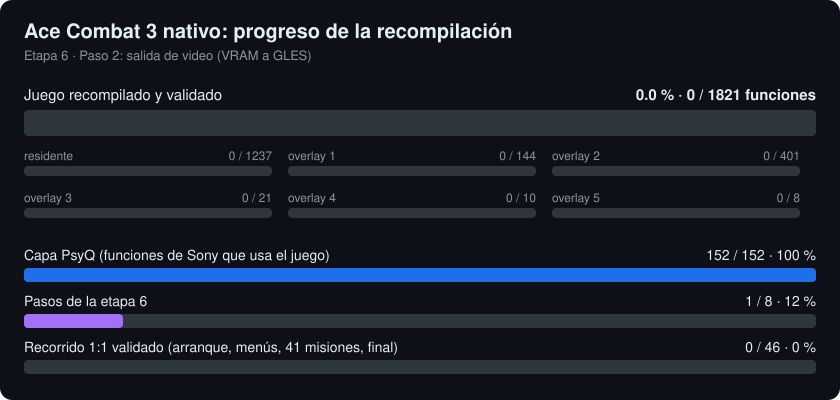

# Ace Combat 3: Electrosphere — ingeniería inversa y port a Android

Proyecto de ingeniería inversa de **Ace Combat 3: Electrosphere** (PS1,
Namco, 1999), con el objetivo a largo plazo de un port nativo a Android con
controles físicos. Desarrollo desde Linux.

## Progreso



La barra verde mide el juego **recompilado a C y validado** contra el código
original: las 1.820 funciones propias del juego, del residente y los 5 overlays.
Se regenera con `make progress`. Plan en
[`docs/11-etapa6.md`](docs/11-etapa6.md).

**Estado:** etapas 1-5 cerradas (formatos, código, rebanada de Android y capa
de compatibilidad PsyQ en `psx/`). **Etapa 6 en curso:** el juego nativo por
recompilación estática. El código recompilado se genera desde el disco del
usuario y no se distribuye.

- 👉 **Agentes de IA: empezad por [`CLAUDE.md`](CLAUDE.md)** (bootstrap) y
  luego [`AGENTS.md`](AGENTS.md) (contrato completo).
- 👉 Estado y siguiente tarea: [`STATUS.md`](STATUS.md)
- 👉 Retomar desde una terminal:
  [`docs/08-continuar-por-consola.md`](docs/08-continuar-por-consola.md)
- 👉 Por qué el objetivo no es "el juego jugable el mes que viene":
  [`docs/05-hoja-de-ruta.md`](docs/05-hoja-de-ruta.md)

## Requisitos

Python 3 estándar. Nada más para las herramientas actuales.

## Uso rápido

```bash
make brief        # estado del proyecto + comprobacion de entorno
make index        # cabeceras de los indices de assets
make inventory    # inventario de los 199 recursos del disco europeo
make records      # tipos de registro y tablas de seccion
make info         # cabeceras PS-EXE de los ejecutables del juego
make files        # tabla de archivos de ambos discos
```

Las imágenes de disco van en `Rom/` y **no se distribuyen**: hay que usar
una copia propia del juego. Ver [`docs/06-legal.md`](docs/06-legal.md).

## Qué hay resuelto

| Área | Estado |
|---|---|
| Estructura de los discos EU y US | ✅ documentada |
| Cabeceras PS-EXE de los 3 binarios | ✅ documentada |
| Confirmación de librerías PsyQ de stock | ✅ |
| Formato de índices `ACE.SPH` / `ACE.BPH` | ✅ resuelto, 100 % de cobertura |
| Extracción de los 199 recursos | ✅ funciona |
| Semántica del campo `tag` de cada entrada | ⚠️ sin resolver |
| Formatos internos de cada recurso | ⚠️ sin empezar |
| Desempaquetado de `ACE.BIN` | ⚠️ sin empezar — bloquea el análisis del código |
| Decompilación | ⬜ no empezada |
| Port Android | ⬜ no empezado |
